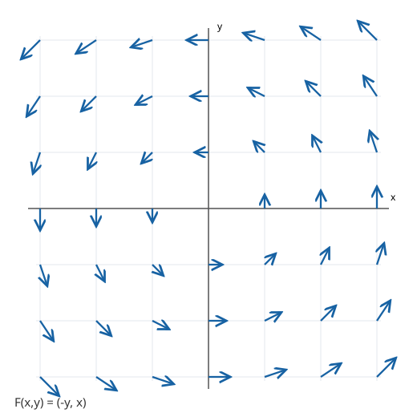

# These are some review problems that will help you prepare for the next Calc 3 midterm.

If you click on **Solution** a worked solution will appear. Only do this after you have attempted the question yourself.

## Double Integrals in Polar Coordinates (15.4)

* Evaluate $\displaystyle \iint_D (x^2+y^2)\,dA$, where $D$ is the region inside $x^2+y^2=9$ and outside $x^2+y^2=1$ in the upper half-plane.

  

  
<strong>Solution</strong>

  The region is the upper half of an annulus. In polar coordinates, $x^2+y^2=r^2$ and $dA=r\,dr\,d\theta$. The bounds are $1\leq r\leq 3$ and $0\leq\theta\leq\pi$.

  $$\iint_D(x^2+y^2)\,dA=\int_0^\pi\int_1^3 r^2\cdot r\,dr\,d\theta$$
  $$=\int_0^\pi\left[\frac{r^4}{4}\right]_1^3d\theta=\int_0^\pi 20\,d\theta=\boxed{20\pi}.$$

  Notice that the extra factor of $r$ comes from the polar area element.

  

## Applications of Double Integrals (15.5)

* A thin plate occupies the triangular region $D$ bounded by $x=0$, $y=0$, and $x+y=2$. Its density is $\rho(x,y)=x+2y$ (mass per unit area). Find the total mass of the plate.

  

  
<strong>Solution</strong>

  The total mass is the integral of density over the region:

  $$M=\iint_D\rho(x,y)\,dA.$$

  The triangle can be described by $0\leq x\leq2$ and $0\leq y\leq2-x$. Thus

  $$M=\int_0^2\int_0^{2-x}(x+2y)\,dy\,dx$$
  $$=\int_0^2\left[xy+y^2\right]_0^{2-x}dx$$
  $$=\int_0^2\bigl(x(2-x)+(2-x)^2\bigr)\,dx$$
  $$=\int_0^2(4-2x)\,dx=\left[4x-x^2\right]_0^2=\boxed{4}.$$

  

## Surface Area (15.6)

*  Find the area of the portion of the plane $z=2x+3y$ above the rectangle $0\leq x\leq2$, $0\leq y\leq1$.

  

  
<strong>Solution</strong>

  For a graph $z=f(x,y)$, the surface area is

  $$S=\iint_D\sqrt{1+(f_x)^2+(f_y)^2}\,dA.$$

  Here $f_x=2$ and $f_y=3$, so

  $$S=\int_0^2\int_0^1\sqrt{1+4+9}\,dy\,dx$$
  $$=\sqrt{14}\,(2)(1)=\boxed{2\sqrt{14}}.$$

  

*  Find the area of the lateral surface of the cylinder parametrized by $\vec r(u,v)=\langle 2\cos u,2\sin u,v\rangle$, where $0\leq u\leq2\pi$ and $0\leq v\leq3$. (Do not include the top or bottom disks.)

  

  
<strong>Solution</strong>

  For a parametrized surface,

  $$S=\iint_D\|\vec r_u\times\vec r_v\|\,du\,dv.$$

  Differentiate:

  $$\vec r_u=\langle-2\sin u,2\cos u,0\rangle,\qquad\vec r_v=\langle0,0,1\rangle.$$

  Then

  $$\vec r_u\times\vec r_v=\langle2\cos u,2\sin u,0\rangle$$
  $$\|\vec r_u\times\vec r_v\|=\sqrt{4\cos^2u+4\sin^2u}=2.$$

  Therefore,

  $$S=\int_0^{2\pi}\int_0^3 2\,dv\,du=\boxed{12\pi}.$$

  

## Triple Integrals (15.7)

*  Evaluate $\displaystyle\iiint_E (x+y+z)\,dV$ over the box $E=[0,1]\times[0,2]\times[0,3]$.

  

  
<strong>Solution</strong>

  Since the region is a box, the bounds are constants:

  $$\iiint_E(x+y+z)\,dV=\int_0^1\int_0^2\int_0^3(x+y+z)\,dz\,dy\,dx.$$

  Integrate with respect to $z$:

  $$=\int_0^1\int_0^2\left[ (x+y)z+\frac{z^2}{2}\right]_0^3dy\,dx$$
  $$=\int_0^1\int_0^2\left(3x+3y+\frac92\right)dy\,dx$$
  $$=\int_0^1(6x+6+9)\,dx=\left[3x^2+15x\right]_0^1=\boxed{18}.$$

  

*  Evaluate the following integral by changing the order of integration to $dy\,dz\,dx$ before integrating.

  $$\int_0^1\int_0^x\int_0^y 2z\,dz\,dy\,dx.$$

  

  
<strong>Solution</strong>

  The original bounds describe the solid $0\leq z\leq y\leq x\leq1$. For the requested order $dy\,dz\,dx$, first fix $x$ and $z$. Then $z\leq y\leq x$. Next, $0\leq z\leq x$, and finally $0\leq x\leq1$.

  The integral in the new order is

  $$\int_0^1\int_0^x\int_z^x 2z\,dy\,dz\,dx.$$

  Evaluate the inner integral:

  $$=\int_0^1\int_0^x 2z(x-z)\,dz\,dx$$
  $$=\int_0^1\left[xz^2-\frac{2z^3}{3}\right]_0^x dx$$
  $$=\int_0^1\frac{x^3}{3}\,dx=\left[\frac{x^4}{12}\right]_0^1=\boxed{\frac1{12}}.$$

  

## Triple Integrals in Cylindrical and Spherical Coordinates (15.8)

* Find the volume of the solid inside the cylinder $x^2+y^2\leq4$, above the plane $z=0$, and below the paraboloid $z=4-x^2-y^2$.

  

  
<strong>Solution</strong>

  In cylindrical coordinates, $x^2+y^2=r^2$ and $dV=r\,dz\,dr\,d\theta$. The bounds are $0\leq\theta\leq2\pi$, $0\leq r\leq2$, and $0\leq z\leq4-r^2$.

  $$V=\int_0^{2\pi}\int_0^2\int_0^{4-r^2}r\,dz\,dr\,d\theta$$
  $$=\int_0^{2\pi}\int_0^2(4-r^2)r\,dr\,d\theta$$
  $$=\int_0^{2\pi}\left[2r^2-\frac{r^4}{4}\right]_0^2d\theta$$
  $$=\int_0^{2\pi}4\,d\theta=\boxed{8\pi}.$$

  

* Find the volume inside the sphere $x^2+y^2+z^2\leq9$ and above the cone $z=\sqrt{x^2+y^2}$.

  

  
<strong>Solution</strong>

  Use spherical coordinates $x=\rho\sin\phi\cos\theta$, $y=\rho\sin\phi\sin\theta$, and $z=\rho\cos\phi$. The cone gives $\rho\cos\phi=\rho\sin\phi$, or $\phi=\pi/4$. Being above the cone means $0\leq\phi\leq\pi/4$.

  The sphere gives $0\leq\rho\leq3$, and the solid goes all the way around the $z$-axis: $0\leq\theta\leq2\pi$. Recall $dV=\rho^2\sin\phi\,d\rho\,d\phi\,d\theta$.

  $$V=\int_0^{2\pi}\int_0^{\pi/4}\int_0^3\rho^2\sin\phi\,d\rho\,d\phi\,d\theta$$
  $$=\int_0^{2\pi}\int_0^{\pi/4}9\sin\phi\,d\phi\,d\theta$$
  $$=18\pi\left[-\cos\phi\right]_0^{\pi/4}$$
  $$=\boxed{18\pi\left(1-\frac{\sqrt2}{2}\right)}.$$

  

## Change of Variables in Multiple Integrals (15.9)

* Evaluate $\displaystyle\iint_R(x+y)\,dA$, where $R$ is the parallelogram bounded by $x+y=1$, $x+y=3$, $x-y=0$, and $x-y=2$. Use the substitution $u=x+y$, $v=x-y$.

  

  
<strong>Solution</strong>

  The four boundary lines become $1\leq u\leq3$ and $0\leq v\leq2$, a rectangle in the $uv$-plane.

  Solve for $x$ and $y$:

  $$x=\frac{u+v}{2},\qquad y=\frac{u-v}{2}.$$

  Compute the Jacobian:

  $$\frac{\partial(x,y)}{\partial(u,v)}=\begin{vmatrix}\frac12&\frac12\\\frac12&-\frac12\end{vmatrix}=-\frac12.$$

  Thus $dA=\left|\frac{\partial(x,y)}{\partial(u,v)}\right|du\,dv=\frac12\,du\,dv$. Since $x+y=u$,

  $$\iint_R(x+y)\,dA=\int_1^3\int_0^2\frac{u}{2}\,dv\,du$$
  $$=\int_1^3u\,du=\left[\frac{u^2}{2}\right]_1^3=\boxed{4}.$$

  

## Vector Fields (16.1)

* Consider the vector field $\vec F(x,y)=\langle-y,x\rangle$. The diagram shows sample vectors at integer grid points. Describe the direction of the field on the positive $x$-axis, positive $y$-axis, negative $x$-axis, and negative $y$-axis. Explain whether the vectors are tangent or perpendicular to circles centered at the origin, and determine the direction of rotation.

  

  

  
<strong>Solution</strong>

  On the positive $x$-axis, $\vec F(x,0)=\langle0,x\rangle$ points {\bf up}. On the positive $y$-axis, $\vec F(0,y)=\langle-y,0\rangle$ points {\bf left}. On the negative $x$-axis the vectors point {\bf down}, and on the negative $y$-axis they point {\bf right}.

  The radial vector from the origin is $\langle x,y\rangle$. Its dot product with the field is

  $$\langle x,y\rangle\cdot\langle-y,x\rangle=-xy+xy=0.$$

  Therefore, except at the origin (where the field is zero), each vector is perpendicular to the radial direction and {\bf tangent} to a circle centered at the origin. The field circulates {\bf counterclockwise}. Its magnitude is $\|\vec F(x,y)\|=\sqrt{x^2+y^2}$, so arrows grow longer farther from the origin.

  

## Line Integrals (16.2)

* Evaluate $\displaystyle\int_C\vec F\cdot d\vec r$, where $\vec F(x,y)=\langle y,x\rangle$ and $C$ is the parabola $y=x^2$ from $(0,0)$ to $(2,4)$. Use a parametrization of $C$ and evaluate the integral directly.

  

  
<strong>Solution</strong>

  Parametrize the curve by $\vec r(t)=\langle t,t^2\rangle$, $0\leq t\leq2$. Then

  $$\vec r\,'(t)=\langle1,2t\rangle,\qquad\vec F(\vec r(t))=\langle t^2,t\rangle.$$

  The line integral becomes

  $$\int_C\vec F\cdot d\vec r=\int_0^2\vec F(\vec r(t))\cdot\vec r\,'(t)\,dt$$
  $$=\int_0^2\bigl(t^2+2t^2\bigr)\,dt=\int_0^2 3t^2\,dt$$
  $$=\left[t^3\right]_0^2=\boxed{8}.$$

  

## Fundamental Theorem of Line Integrals (16.3)

* Let $\vec F(x,y)=\langle 2xy+3,\,x^2+2y\rangle$, and let $C$ be any piecewise smooth curve from $A=(0,1)$ to $B=(2,3)$. Check whether $\vec F$ is conservative. If it is, find a potential function $f$ and use the Fundamental Theorem of Line Integrals to evaluate $\displaystyle\int_C\vec F\cdot d\vec r$.

  

  
<strong>Solution</strong>

  Write $\vec F=\langle P,Q\rangle$, where $P=2xy+3$ and $Q=x^2+2y$. First check the mixed partials:

  $$\frac{\partial P}{\partial y}=2x,\qquad\frac{\partial Q}{\partial x}=2x.$$

  These are equal everywhere. Since $P$ and $Q$ have continuous first partial derivatives on the simply connected domain $\mathbb R^2$, the vector field is **conservative**.

  To find a potential function $f$, solve $f_x=P$:

  $$f(x,y)=\int(2xy+3)\,dx=x^2y+3x+g(y).$$

  Differentiate with respect to $y$ and compare with $f_y=Q$:

  $$f_y=x^2+g'(y)=x^2+2y,$$
  $$g'(y)=2y\implies g(y)=y^2+C.$$

  We may choose $f(x,y)=x^2y+3x+y^2$. By the Fundamental Theorem of Line Integrals,

  $$\int_C\vec F\cdot d\vec r=f(B)-f(A)$$
  $$=f(2,3)-f(0,1)$$
  $$=(4\cdot3+6+9)-(1)=27-1=\boxed{26}.$$

  The answer is independent of the path between $A$ and $B$.

  

## Navigation

* [Back to the Midterm 3 Page](calc3_mt3.html)
* [Back to the Calc 3 Main Page](../../calc3.html)
* [Back to Home](../../index.html)
